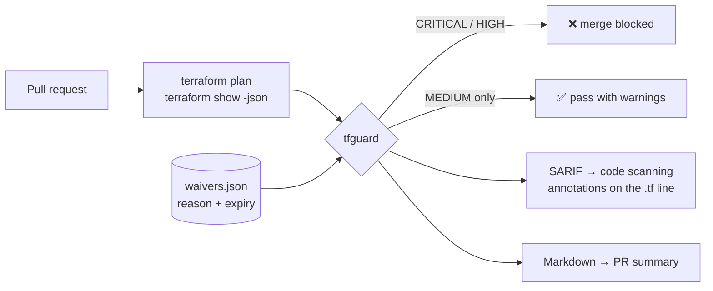

# tf-guardrails

[](https://github.com/Subhamsharm25/tf-guardrails/actions/workflows/ci.yml)
[](LICENSE)

**A policy gate for Terraform pull requests on AWS, Azure and GCP.** It reads `terraform plan` output
and blocks the merge when a change would open SSH or RDP to the internet, make storage or a database
public, drop encryption, or leave resources without an owner and cost-center tag. Results show up as a
pull request summary, as SARIF for GitHub code scanning (with file and line), and as JSON. Exceptions
are allowed, but each needs a reason and an expiry date.

It needs only the Python standard library, so it runs in any CI image, as a Docker image, or as a
one-line GitHub Action.

## The problem

Most cloud breaches are misconfigurations, not exploits: an S3 bucket left public, an RDP port open to
`0.0.0.0/0`, a database with a public IP. With infrastructure as code, those mistakes arrive through an
ordinary pull request that a busy reviewer approves. This is why platform teams use "shift-left" policy
checks (OPA/Conftest, Checkov, tfsec, Sentinel in Terraform Cloud). Untagged resources are the FinOps
version of the same problem: spend nobody can attribute.

tf-guardrails is a small, readable implementation of that gate:

* It evaluates the **plan**, not the source. Values from variables, modules and `count` are resolved, so
  `cidr_blocks = var.allowed` is checked with its real value.
* It follows **references between resources**, because many controls are separate resources. An S3
  bucket is only private if an `aws_s3_bucket_public_access_block` points at it, and in a plan that
  pointer is still "known after apply". The gate reads it from the plan's `configuration` section.
* **Waivers expire.** A permanent exception is how guardrails rot. An expired waiver is reported and
  blocks again.



## Rules

| ID | Severity | Cloud | Blocks when |
|---|---|---|---|
| `AWS-SG-001` | CRITICAL | AWS | a security group (inline, `aws_security_group_rule` or `aws_vpc_security_group_ingress_rule`) opens 22/3389 or all ports to `0.0.0.0/0` / `::/0` |
| `AZ-NSG-001` | CRITICAL | Azure | an NSG rule allows inbound 22/3389 or `*` from `*` / `Internet` |
| `GCP-FW-001` | CRITICAL | GCP | an enabled ingress firewall allows tcp 22/3389 or all ports from `0.0.0.0/0` |
| `AWS-S3-001` | HIGH | AWS | a bucket has no public access block with all four settings on |
| `AWS-RDS-001` | HIGH | AWS | an RDS instance is unencrypted or publicly accessible |
| `AZ-ST-001` | HIGH | Azure | a storage account allows HTTP, TLS < 1.2 or public blobs |
| `GCP-GCS-001` | HIGH | GCP | a bucket lacks uniform access or enforced public access prevention |
| `AWS-S3-002` | MEDIUM | AWS | a bucket has no versioning |
| `TAG-001` | MEDIUM | all | a taggable resource lacks `owner` or `cost-center` (provider default tags and labels count) |

`--fail-on` picks the threshold (default `HIGH`). `python -m tfguard --list-rules` prints the catalogue.

## Use it

**GitHub Action** (in any repository):

```yaml
- run: terraform plan -out tfplan && terraform show -json tfplan > plan.json
- uses: Subhamsharm25/tf-guardrails@main
  with:
    plan: plan.json
- uses: github/codeql-action/upload-sarif@v3   # optional: annotations in the Files changed tab
  if: always()
  with: { sarif_file: tfguard.sarif }
```

**CLI / Docker:**

```bash
pip install git+https://github.com/Subhamsharm25/tf-guardrails
tfguard plan.json --sarif out.sarif --markdown summary.md --json out.json
docker run --rm -v "$PWD:/work" tf-guardrails:local plan.json
```

**Waivers** (`tfguard-waivers.json`, `resource` may end with `*`):

```json
[{"rule": "AZ-ST-001", "resource": "azurerm_storage_account.data",
  "reason": "OPS-482 legacy TLS client", "expires": "2027-01-31"}]
```

Exit codes: `0` pass, `1` blocked, `2` bad input.

## CI/CD

`ci.py` holds every stage. The [GitHub workflow](.github/workflows/ci.yml) and the [Jenkinsfile](Jenkinsfile)
only call it.

| Stage | What it proves |
|---|---|
| `lint` | ruff lint + format |
| `unit` | 29 tests: every rule's pass and fail cases, port ranges, IPv6, all-ports rules, references through `count`, tag fallbacks, waivers, SARIF, Markdown and JSON outputs, exit codes (an I/O failure is exit 2, never a fake verdict). Coverage ≥ 90% (currently 95%) |
| `plan` | `terraform fmt`; real **offline** plans of the AWS+GCP examples with the official providers (no credentials); `validate` for the Azure examples |
| `policy` | tfguard must report **exactly** the findings in [`examples/expected.json`](examples/expected.json) for every example; any drift fails. Active waiver unblocks, expired waiver blocks |
| `build` / `scan` | container image; Trivy finds no fixable HIGH/CRITICAL CVEs |
| `container` | the image blocks a real plan and writes SARIF with a file and line for all 9 findings |
| `action-selftest` (Actions) | the published action used as another repo would: passes the good plan, blocks the bad one |

```bash
pip install -e ".[dev]" && python ci.py all
```

## Scope and limitations

* Plans for the AWS and GCP examples are real, generated offline by the official providers. The
  `azurerm` provider has to sign in to Azure even to plan, so the Azure examples are validated with
  Terraform and their rules are tested against plan JSON written to mirror those files
  (`plan.fixture.json`).
* Nine focused rules, not a full benchmark. CIS-scale coverage is what Checkov or tfsec provide; this
  project is about the gate mechanics (plan semantics, references, waivers, reporting).
* Values that are "known after apply" cannot be judged at plan time. Such resources are skipped, not
  guessed.

## Research directions

Learning which rules reviewers waive and why, to find noisy policies; ranking findings by blast radius
using the plan's dependency graph; checking policy equivalence across clouds (is "private bucket" the
same property on S3, Blob and GCS?); and measuring how often plan-time checks miss problems that only
appear after apply.

## License

MIT © 2026 Subham Sharma
